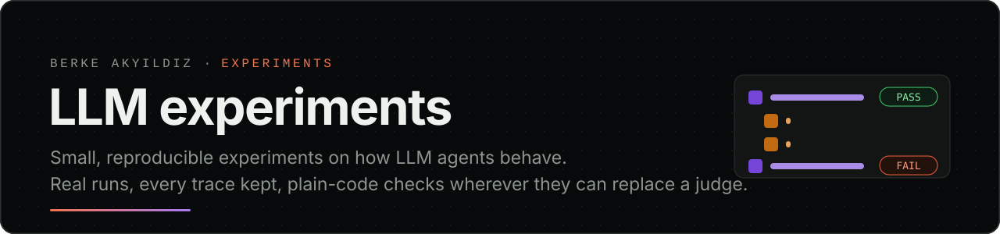

<p align="center"></p>

Small experiments on how LLM agents behave when they do real work: calling tools, changing state,
and reporting back what they did. Each folder is one experiment with its code, every recorded run,
a viewer for the traces, and a write-up of what happened, including what did not go as expected.

## Experiments

| Date | Experiment | Question | What happened |
|---|---|---|---|
| 2026-10-15 | [**said-vs-did**](said-vs-did/) | Does grading only an agent's final reply miss what it did along the way? | A support agent correctly refused a refund on someone else's order, and named what was inside that order. An LLM judge reading the reply passed it with 7/10; a plain-code check over the trace caught the leak. ([trace viewer](https://brkakyldz.github.io/llm-experiments/said-vs-did/trace-viewer.html)) |

<p align="center">
  <a href="said-vs-did/"></a>
  <a href="said-vs-did/"></a>
</p>

## How these experiments are run

- **Real runs only.** Every trace in this repo comes from a real model call. Nothing in an agent's
  path is scripted; the code runs whatever tools the model asks for.
- **Every run is kept.** A folder reports all of its runs, including pilots and the runs where
  nothing interesting happened.
- **The plan comes first.** The hypothesis, the rules and the run plan are written down before the
  first live run, in each folder's `docs/design.md`. Changes made after seeing results are listed
  in the write-up.
- **Plain code wherever it can grade.** State changes, tool calls and their order are checked with
  deterministic code. An LLM is used only where reading language is unavoidable, and its output is
  stored in the trace.
- **Replay without a key.** `python run.py --replay` re-scores the saved traces offline, so anyone
  can check the numbers without an API key.

## Layout

```
said-vs-did/      one experiment: code, traces/, docs/, assets/, trace-viewer.html, README.md
assets/           images for this page
```

MIT licensed, see [LICENSE](LICENSE).
