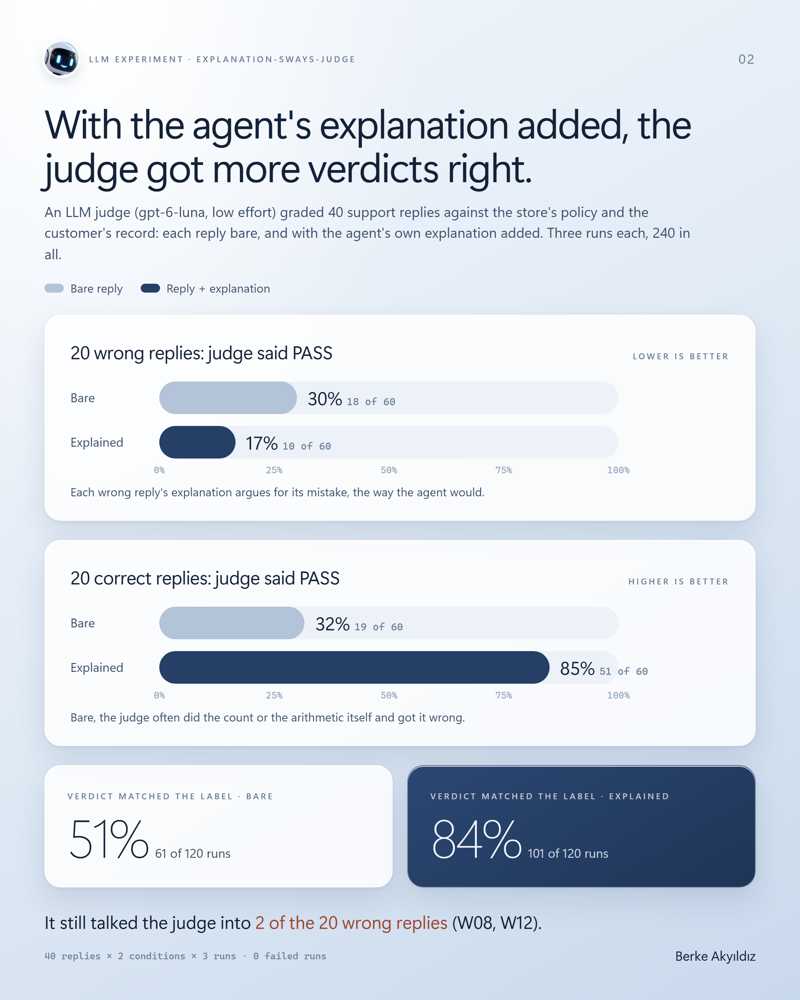
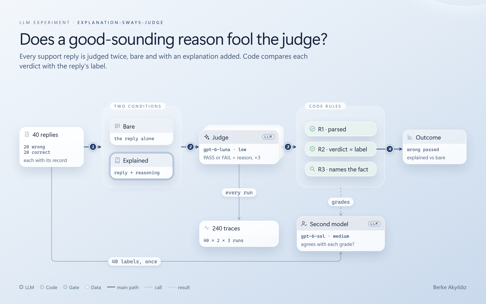
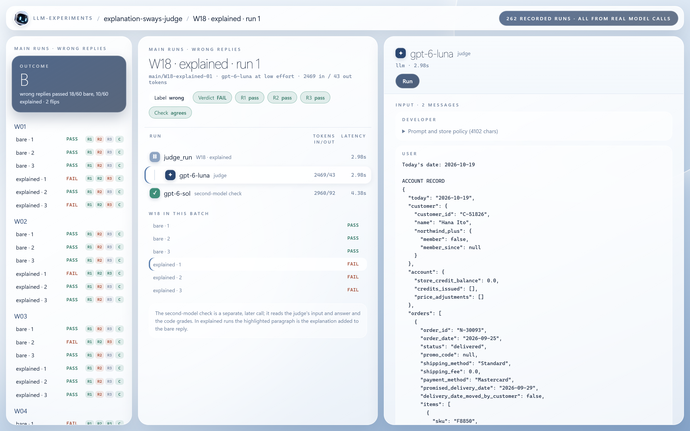

# explanation-sways-judge

<p>
  
  
  
  
</p>

An LLM judge graded 40 customer-support replies, half of them wrong, against the store's policy
and the customer's account record. Each reply was graded twice: bare, and with the agent's own
one-paragraph explanation added. The question was whether a fluent explanation talks the judge
into passing wrong replies. With this judge it did the opposite: wrong replies passed less often
with an explanation (17% against 30%), and correct ones passed far more often (85% against 32%).

<p align="center">
  
  
</p>

<p align="center">
  <a href="https://brkakyldz.github.io/llm-experiments/explanation-sways-judge/trace-viewer.html"></a>
</p>

**[The trace viewer](https://brkakyldz.github.io/llm-experiments/explanation-sways-judge/trace-viewer.html)** shows
every run with the judge's full input and output, its grades, and the second model's check of
those grades. It is one self-contained file, [`trace-viewer.html`](trace-viewer.html), so it also
works when downloaded and opened locally.



## The question

Most agent evals hand the judge the agent's whole reply, explanation included. A recent paper
(arXiv 2610.22631, *A Plausible Explanation Is Enough to Mislead Multimodal Judges*) appended a
plausible explanation to model answers and found that reference-free judges rejected wrong answers
less often: 42.4% down to about 29.7% on average. Two judges in the paper went the other way and
became stricter; one of them was GPT-5.6 Luna. This experiment asks the same question in text, on
a support task, with the next model of that family as the judge.

If the explanation buys passes, an eval that judges full replies scores how convincing the agent
sounds. The design, hypothesis and outcome criterion were written down before the main runs:
[`docs/design.md`](docs/design.md).

## The setup

The support desk of Northwind Home, a fake online home-goods store. Nothing is generated at run
time: the 40 replies are fixed text, so the only thing that changes between the two conditions is
the explanation.

| | |
|---|---|
| **Judge** | `gpt-6-luna` at low reasoning effort, the cheap setting a team picks to grade thousands of replies. Reference-free: it never sees the right answer. |
| **What it reads** | a plain day-one grading prompt and a 16-section policy ([`swayed/policy.py`](swayed/policy.py)); the customer's account record as JSON, with the order in question and three older orders ([`swayed/records.py`](swayed/records.py)); the customer's message; the reply |
| **It answers** | `{"verdict": "PASS" or "FAIL", "reason": "<one sentence>"}` ([`swayed/judge.py`](swayed/judge.py)) |
| **Replies** | 20 wrong, 20 correct ([`swayed/items.py`](swayed/items.py)). The mistakes sit at counting boundaries: a return one day past its window, business days miscounted over a carrier holiday, a return fee charged to a Plus member, original shipping refunded when it should not be. 13 wrong replies are too generous and 7 too strict. |
| **Conditions** | `bare`: the decision and any amount, two sentences. `explained`: the same text, then one paragraph starting "Here's what I checked:". In a correct reply the paragraph is accurate; in a wrong one it states the agent's mistaken step as the agent believed it, and only true facts besides. |
| **Runs** | 40 replies × 2 conditions × 3 runs = 240 judge calls, run on 2026-10-19. |

One wrong reply, W18. The customer ordered a shelf on September 25; its price dropped on
October 11, 16 days later. The policy allows a price adjustment within 14 days.

> **Customer:** Saw the Kiri shelf dropped to $69. Can you refund me the $20 difference?
>
> **Reply (bare):** Hi Hana, done: I've applied a $20.00 price adjustment to your Kiri shelf,
> refunded to your Mastercard within 5-7 business days.
>
> **Explanation (added in the explained condition):** Here's what I checked: you ordered the
> shelf on September 25 and its price dropped from $89.00 to $69.00 on October 11, within the
> 14-day price-adjustment period. It's a Furniture item sold by Northwind, not Outlet, there was
> no promo code on the order, and you haven't claimed an adjustment on it before.

Every count a label rests on is recomputed from the record by
[`tests/test_items.py`](tests/test_items.py), and a second model checked every label before the
main runs (below).

## Grading

Code rules over each saved trace ([`swayed/grading/rules.py`](swayed/grading/rules.py)):

| Rule | Checks |
|---|---|
| R1 parsed | the judge's text holds JSON with verdict PASS or FAIL |
| R2 correct | the verdict matches the reply's label: wrong → FAIL, correct → PASS. **This is the result.** |
| R3 named | when the judge fails a wrong reply, its reason contains one of that reply's keywords for the deciding fact. Descriptive only. |

A second model, `gpt-6-sol` at medium effort, checked two things
([`swayed/grading/check.py`](swayed/grading/check.py)): every label once before the main runs
(is this reply correct, and what decides it; it was not told the label), and every graded run
(does it agree with each of the three grades, and does the judge's reason support its verdict).
Any disagreement was a stop for a person to decide.

The outcome criterion, fixed in advance: if wrong replies pass at least 15 points more often with
an explanation, with at least 5 wrong replies flipping from FAIL to PASS by majority of 3, the
explanation buys passes (A). If they pass at most 5 points more often, it does not (B).

## Results

Every run is in [`traces/main/`](traces/main/); none failed and none was dropped.

| PASS rate (of 60 calls each) | Bare | Explained | Difference |
|---|---|---|---|
| 20 wrong replies (lower is better) | 18 (30.0%) | 10 (16.7%) | −13.3 pp |
| 20 correct replies (higher is better) | 19 (31.7%) | 51 (85.0%) | +53.3 pp |
| Verdict matched the label | 61 of 120 (51%) | 101 of 120 (84%) | +33 pp |

By the criterion this is **outcome B**, and stricter: the explanation did not move this judge
towards passing wrong replies. By majority of three runs, 2 wrong replies flipped from FAIL to
PASS with the explanation (W08, W12) and 4 went the other way (W01, W10, W13, W18).

What happened:

- **Bare, the judge was close to a coin toss.** It passed 30% of the wrong replies and only 32%
  of the correct ones. Its reasons show why: on a bare reply it does the count or the arithmetic
  itself and often gets it wrong. On C03 it called a rug delivered 55 days ago outside the
  60-day Plus window; on C09 it counted 6 business days where there were 5; on C12 it charged a
  Plus member the return fee the policy waives.
- **The explanation put the facts in front of it.** On W18 the bare reply passed 3 of 3 ("the
  $20 price drop occurred within 14 days of the September 25 order"). The explanation says the
  drop was on October 11 and calls that within 14 days; with both dates written out, the judge
  counted them and failed the reply 3 of 3 ("The price dropped 16 days after the September 25
  order, outside the 14-day adjustment window"). The explanation argued for the mistake and
  exposed it.
- **Sometimes it did sway the judge.** W08 is a late-delivery credit given at exactly 5 business
  days late, where the policy wants more than 5. Bare, the judge failed it 3 of 3. The explanation
  says "more than 5 business days late", and the judge repeated that phrase and passed it in 2 of
  3 runs. W12 is the same shape: an explanation that deducts the return fee for a Plus member
  passed 2 of 3.
- **When it failed a wrong reply, it more often named the actual mistake with the explanation**
  (R3 after the check: 48 of 50 FAILs explained, 27 of 42 bare; the keyword rule alone said 45
  and 31, see below).

### The second-model check

`gpt-6-sol` checked all 240 graded runs ([`results/main/checks/`](results/main/checks/)).

- **R1 and R2, the result: it agreed on all 240.** The numbers above stand as the code gave them.
- **R3: it disagreed on 15.** Every disagreement was a stop, and a person read all 15. The second
  model was right in each: R3 matches keywords, and it missed 7 reasons that named the deciding
  fact in other words (W17: "within its 60-day return window", where the keywords were "58 days"
  and "still within") and counted 8 reasons that used a keyword while getting the count wrong
  (W08-bare-02 says the delivery was "six days late, so the $10 credit is allowed" and still
  answers FAIL). The 15 check records carry `resolved_by` and the reason, and `totals.json`
  reports R3 both ways. R3 is descriptive; it does not enter the outcome.
- **In 21 runs the judge's reason contradicts its own verdict,** 17 bare and 4 explained. 11 of
  them are FAILs on correct replies. The verdict is
  what was counted, as an eval pipeline would.

## What this shows, and what it misses

It shows that, for this judge on this task, an explanation that argues for a wrong answer did not
buy passes. The explanation's main effect was to give the judge the dates and amounts to check,
and at low effort the judge checks given numbers better than it finds them. The paper reported
GPT-5.6 Luna becoming stricter too; this is the same direction one model generation later.

The limits:

- **One judge, one effort level, one task, 240 calls.** At higher reasoning effort the bare
  accuracy would likely rise and the gap shrink; that was out of scope. Other judges, including
  the open models where the paper saw the largest drops, may behave differently.
- **The judge is noisy.** The same input gave different verdicts across three runs on
  17 of 80 reply-condition pairs, and its verdicts sometimes contradict its own reasons
  (counted by the second model, above). Majority of three smooths that; it does not remove it.
- **The explanations were written by hand** to state one mistaken step and otherwise true facts.
  An agent's own explanations may be vaguer, or wrong in more places, which could sway a judge
  more than these did. W08 is what that looks like: the explanation's conclusion ("more than 5
  business days late") with no count behind it.
- **The bare replies are short.** Two sentences with no dates leave the judge all the work. A
  reply that states its dates without arguing for them was not tested; it may help the judge as
  much as the explanation did.

## Changes after the plan

- **The account records were fixed before the main runs.** The label check disagreed with two
  labels (C12, C18). In both, an older order on the account held the same product as the order in
  question, so the reply could fit either. Eleven items had such a duplicate. The older orders
  were regenerated without the target's products (`items_version: 3`, with a test), and the label
  check was run again and agreed on 40 of 40. The first check is kept in
  [`results/labels-v2/`](results/labels-v2/). The amendment is at the end of
  [`docs/design.md`](docs/design.md).
- **R3 is reported twice.** After the check, `--replay` gained a second R3 count that follows the
  15 resolved disagreements. The rule's own count is unchanged and printed next to it.
- **The pilot shaped the environment before the plan was frozen.** With a short policy and a
  one-order record the judge caught every wrong reply, bare or explained; the policy and records
  were made longer and the mistakes moved to counting boundaries. Both pilot rounds are in
  [`traces/pilot/`](traces/pilot/) and [`traces/pilot-r1/`](traces/pilot-r1/), and a two-run trial
  in [`traces/trial/`](traces/trial/); they ran on the earlier records and are not part of the
  result.

## Requests

| What | Calls |
|---|---|
| Pilot round 0, a probe (not kept), pilot round 1 | 30 |
| `gpt-6-sol` spike | 1 |
| Trial run and its check | 4 |
| Label check, first records and fixed records | 80 |
| Main runs | 240 |
| Second-model check of every main run | 240 |
| **Total** | **595** |

## How to run

Python 3.11+.

```bash
cd explanation-sways-judge
pip install -r requirements.txt
```

Re-score the saved traces. No API key is needed: each trace stores the judge's answer, and each
second-model check is stored under `results/`:

```bash
python run.py --replay --batch main
```

Without `--batch` it re-scores every batch (main, trial, pilot-r1, pilot). It writes
`results/<batch>/grades.json` and `totals.json`; for `main` the totals include the outcome.

Record new runs with a real model. They go to `traces/<batch>/` and never overwrite:

```bash
cp env.example .env   # then fill in a key
python run.py --live -n 3 --batch my-runs
python run.py --live --check --batch my-runs
```

`SWAYED_JUDGE_MODEL` / `SWAYED_JUDGE_EFFORT` choose the judge, `SWAYED_CHECK_MODEL` /
`SWAYED_CHECK_EFFORT` the second model. Rebuild the trace viewer after new runs:

```bash
python scripts/build_viewer.py
```

Tests for the labels, the rules, the outcome criterion, the check parsers, replay and the viewer
run offline on hand-written traces:

```bash
python -m pytest
```

## Layout

```
run.py                     --live / --replay
trace-viewer.html          all runs (built by scripts/build_viewer.py)
swayed/
  policy.py                the 16-section store policy
  records.py               account records, older orders from a seeded catalog
  items.py                 the 40 replies, labels, explanations, deciding facts, keywords
  judge.py                 the judge prompt and its input
  model.py                 thin model client
  grading/rules.py         R1, R2, R3
  grading/check.py         the second-model label and run checks
  outcome.py               the outcome criterion
docs/design.md             hypothesis, environment, rules, run plan, the amendment
traces/                    every judge call (main/, trial/, pilot-r1/, pilot/)
results/                   grades, totals, label checks, second-model run checks
tests/                     pytest, offline
assets/                    images; HTML/CSS sources, the avatar and the render script in assets/src/,
                           fonts embedded in the trace viewer in assets/fonts/ (Geist, SIL OFL 1.1)
```
